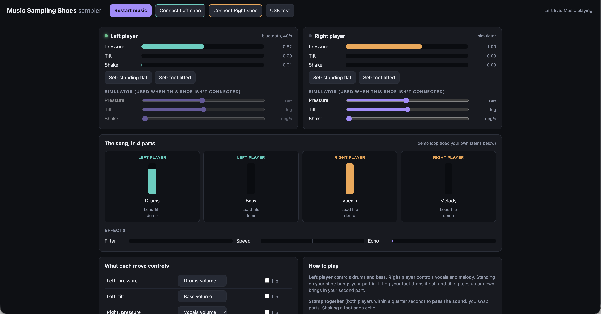
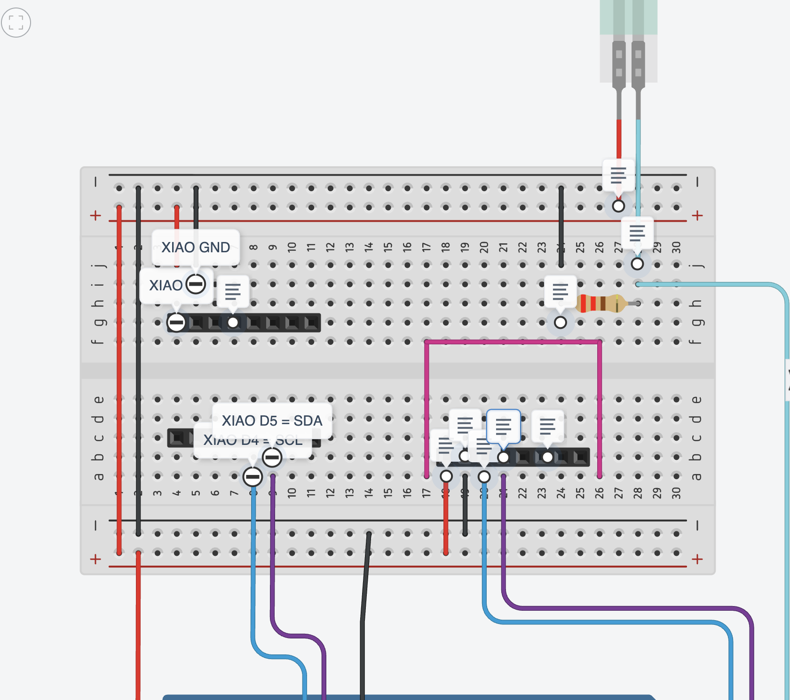
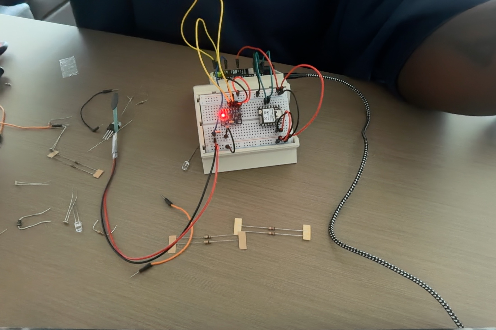
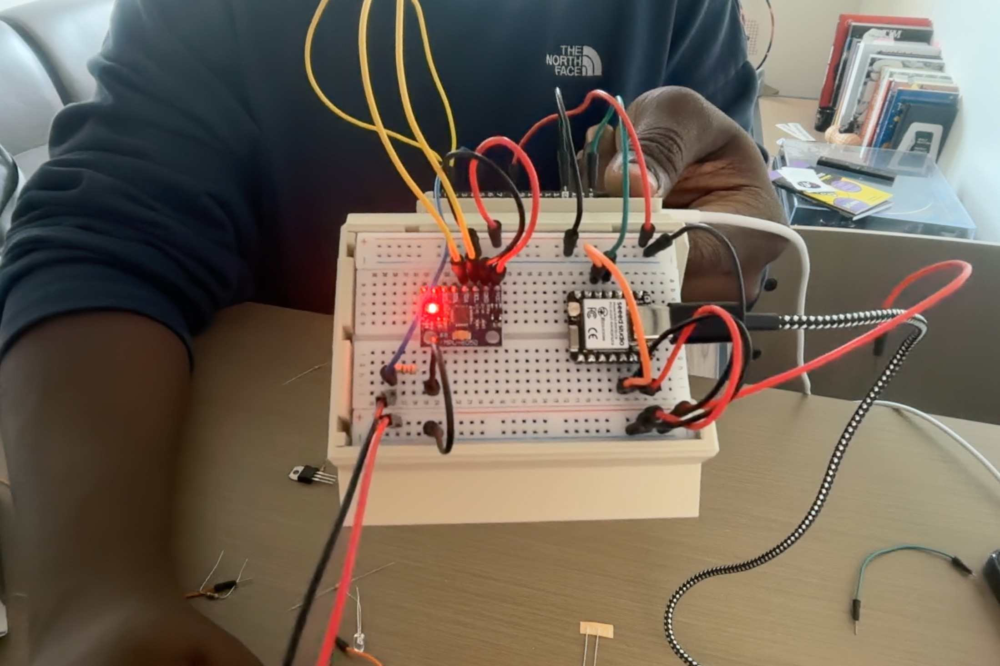

# Music Sampling Shoes

Two people. One shoe each. Together you remix a song with your feet.

## Pictures

**The music app** with the left shoe live over Bluetooth (40 updates a second). The right player is on the simulator.



**Tinkercad wiring** for one shoe's breadboard: the XIAO (left), the gyro (right, bottom half), and the FSR with its 220 ohm resistor (top right).



**The real left-shoe build** in its 3D-printed tent case: the XIAO ESP32-C6 (small black board) and the MPU-6050 gyro (purple board, red light) on the breadboard, with the Arduino UNO R4 Minima underneath.




## What's in this folder

| Folder | What it is | Goes on |
|---|---|---|
| `minima_foot/` | Reads the pressure sensor and the gyro | Each Arduino Minima |
| `xiao_radio/` | Sends the numbers to the laptop by Bluetooth | Each XIAO ESP32-C6 |
| `sampler/` | The music app | The laptop (open in Chrome) |
| `tinkercad/` | The Tinkercad practice model | Tinkercad (two Unos) |

Before you upload, set `FOOT` to `L` for the left shoe or `R` for the right shoe. Do it in both the Minima code and the XIAO code.

## Parts (for both shoes)

| Part | How many |
|---|---|
| Arduino UNO R4 Minima | 2 |
| Breadboard | 2 |
| XIAO ESP32-C6 (pre-soldered) | 2 (+1 spare) |
| GY-521 MPU-6050 gyro (pre-soldered) | 2 (+1 spare) |
| FSR pressure sensor | 2 (+1 spare) |
| 220 ohm resistor (red red brown) | 2 (one per shoe, for the FSR) |
| Jumper wires | a bunch |
| USB power bank + USB-C cable | 2 |

No soldering. Everything pushes into the breadboard.

## Wiring (same on both shoes)

**Pressure sensor (FSR), goes in the sole**
- One leg → 5V
- Other leg → A0
- 220 ohm resistor (red red brown) from A0 → GND

**Gyro (MPU-6050), goes on the breadboard**
- VCC → 5V
- GND → GND
- SCL → Minima A5 (same line as the SCL pin)
- SDA → Minima A4 (same line as the SDA pin)

**XIAO, goes on the breadboard**
- 5V → Minima 5V
- GND → Minima GND
- D4 → Minima SCL
- D5 → Minima SDA
- No resistors. The XIAO shares the gyro's two wires (SDA/SCL), and the gyro board keeps them at a safe 3.3 V.
- D4 and D5 are swapped from what's printed on the XIAO (so the wires don't cross). The code already knows this.

**Power:** power bank → Minima's USB-C port. That powers everything.

## Arduino IDE setup

1. Minima: Boards Manager → install "Arduino UNO R4 Boards" → pick *Arduino UNO R4 Minima*.
2. XIAO: File → Preferences → paste this in "Additional boards" →
   `https://raw.githubusercontent.com/espressif/arduino-esp32/gh-pages/package_esp32_index.json`
   Boards Manager → install "esp32 by Espressif" → pick *XIAO_ESP32C6*.
   Tools → USB CDC On Boot → Enabled.
3. Upload each XIAO **before** wiring it to the Minima.

## Test in this order

1. Open the music app (see below). Press **Start music**. Move the sliders. It works with no shoes!
2. Plug in one Minima. Upload. Open Serial Monitor (115200). You should see numbers like `L,1830,2.41,-0.87,12`. Press the FSR: the 2nd number goes up.
3. In the music app, click **USB test** and pick the Minima. The bars move when you press.
4. Add the XIAO. In the app, click **Connect Left shoe** and pick `MusicShoe-L`.
5. Build the right shoe the same way with `R`.
6. Put them on. Stand flat, click **Set: standing flat**. Lift your foot, click **Set: foot lifted**. Play!

## Opening the music app

Bluetooth only works if you open it this way:
```
cd sampler
python3 -m http.server 8000
```
Then go to `http://localhost:8000` in Chrome.

## How to play

| Move | Left player | Right player |
|---|---|---|
| Stand on your shoe | Drums play | Singing plays |
| Tip your toes up or down | Bass plays | Melody plays |
| Shake your foot | Echo | Echo |
| **Both stomp at the same time** | **You swap parts!** | |

## Using a real song

```
pip install demucs
demucs -n htdemucs song.mp3
```
This splits the song into `drums.wav`, `bass.wav`, `vocals.wav`, `other.wav`. Load each one into its box in the app.

## Tinkercad

Make two Unos (Left and Right). Each one gets a Force Sensor and a Tilt Sensor. Paste `tinkercad_one_shoe.ino` into both and change `FOOT` to `R` on the second.
- Force Sensor: 5V → sensor → A0, 10k resistor from A0 → GND
- Tilt Sensor: one side → pin 2, other side → GND

## If something goes wrong

- **`MPU-6050 NOT FOUND`**: SDA and SCL are swapped, or VCC isn't plugged in.
- **XIAO says `minima: NO DATA`** or the Minima says `xiao: NOT ANSWERING`: check the D4/D5 wires and that the XIAO has 5V and GND.
- **Shoe isn't in the Bluetooth list**: is the power bank on? Did you set FOOT right?
- **Pressure is always high or low**: click the two Set buttons again.
- **Tilt feels backwards**: tick **flip** in the app.
- **Code won't upload to the XIAO**: hold BOOT, tap RESET, let go of BOOT, try again.
